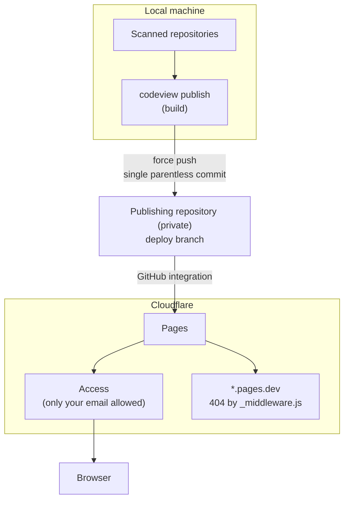

[🇯🇵 日本語](README.md) | [🇬🇧 English](README.en.md)

# codeview

[](https://github.com/yktsnet/codeview/actions/workflows/ci.yml)

Turns your local git repositories and their GitHub issues into static HTML, and serves them through Cloudflare Pages + Access as a code browser only you can read.

GitHub's web and mobile apps are heavy when all you want is to read code. codeview converts the HEAD of your local repositories into pages that read fine even without JavaScript, so you can browse them lightly from your phone while away. It can put the repositories and issues of up to two accounts, such as a personal GitHub and a work GitHub, side by side on one site.

## Quick Start

You need `git`, plus an authenticated `gh` if you want issues. Python 3.11 or later.

```sh
# Nix
nix profile install github:yktsnet/codeview

# pip
pip install git+https://github.com/yktsnet/codeview
```

Write a `codeview.toml` in the directory you will work from.

```toml
[[roots]]
group = "src"
children = "~/src"     # read every git repository directly under it

[[accounts]]
name = "me"
hosts = ["github.com"]
groups = ["src"]
```

```sh
codeview build   # generate ./public/ and ./functions/
codeview serve   # check it at http://localhost:8787
```

That is enough to read locally. To read over the internet, continue to [Publishing](#publishing) below.

## Configuration

The config is TOML, read from the `CODEVIEW_CONFIG` environment variable, or `codeview.toml` in the working directory if unset. If it is missing, malformed or has unknown keys, codeview prints `error:` and stops before generating anything.

| Section | Meaning |
|---|---|
| `[[roots]]` | Where to scan. A `group`, plus exactly one of `path` (that directory is one repository) or `children` (every git repository directly under it). The order is the order of the left menu on the top page |
| `[scan]` | `skip_dirs` (directory names not to scan), `exclude_prefixes` (path prefixes not to output), `skip_exts` (extensions not to output) |
| `[[accounts]]` | The unit issues are grouped by; 1 or 2 of them. `name`, `hosts` (hosts of the `origin` remote), `groups` (the fallback when there is no remote), `issues` (the default `github`, or the module name of an extension that returns issues), `gh_config_dir` (the gh config dir used when `issues = "github"`) |
| `[publish]` | The `remote` (default `origin`) and `branch` (default `deploy`) to publish to |
| `[plugins]` | Extensions to load (`modules`). Per-extension settings go in `[plugins.<last part of the module name>]` |

An example with two accounts, where the work GitHub is reached through an SSH Host alias (`github-work`).

```toml
[[roots]]
group = "own"
children = "~/github"

[[roots]]
group = "work"
children = "~/work"

[scan]
skip_dirs = ["archive"]
exclude_prefixes = ["secrets/"]
skip_exts = [".png", ".jpg"]

[[accounts]]
name = "me"
hosts = ["github.com"]
groups = ["own"]

[[accounts]]
name = "work"
hosts = ["github-work"]
groups = ["work"]
gh_config_dir = "~/.config/gh-work"   # config dir where you ran gh auth login with the work account
```

## What You Get

- **Code**: one page per file at each repository's HEAD, highlighted with Pygments. Markdown is rendered, and a directory's README is shown below its listing. Uncommitted changes, history and branches are not shown
- **Issues**: open issues per account in one list (`/issues/<account>/`), and a page per issue with the body and comments, oldest first. `#N` in the text links to this site's page when it is an open issue in the same repository. GitHub bodies and comments are treated as other people's writing, and raw HTML is shown as text
- **Copy**: on a file page, the file name copies the local absolute path, a line number copies `path:line`, and `Copy file` copies the whole file. Hand what you found on your phone straight to a terminal or an agent
- **Width**: Markdown stops at about 900px, issues at about 1000px, code at about 1280px. At 760px or less it becomes a single column for phones

If fetching issues fails for a repository, the build does not stop; it shows `fetch failed: <repo>` above the list.

## Extensions

The core outputs only code and issues. Anything else comes from the Python modules listed in `[plugins] modules`. An extension placed in the same directory as the config file can be loaded. If loading fails, codeview stops before generating anything.

An extension has only the functions it needs from the following.

| Function | Role |
|---|---|
| `css(ctx)` | Appended to the end of the core CSS |
| `side(ctx)` | A block inserted at the top of the left menu on the top page |
| `home(ctx)` | HTML shown on the right of the top page. `None` shows nothing |
| `build(ctx)` | Writes its own pages into `public/` and `functions/` |
| `before_publish(ctx)` | Called before publish detects changes |
| `fingerprint(ctx)` | One line added to change detection |
| `issues(ctx, account, repos)` | When an account's `issues` names this module, returns that account's open issues (`codeview.issues.Issue`) |

`ctx` holds the config, the scanned repositories, the output directories, the `[plugins.<name>]` table (`ctx.options`), and `ctx.read(repo, path)` to read a file at HEAD. With `issues()`, a ledger other than GitHub (such as issue files inside a repository) can be the source of issues.

## Publishing

The generated files contain the code of every repository. **Keep the repository you publish from (the one holding `codeview.toml`) private, and never put the generated files anywhere public.**



### Publish

```sh
codeview publish               # build and push to the deploy branch
codeview publish --dry-run     # create the commit without pushing
codeview publish --if-changed  # do nothing if nothing changed since the last publish
```

`publish` creates a single parentless commit holding only `public/` and `functions/`, and force-pushes it to the `[publish]` branch. It does not touch the working tree or the index. Cloudflare Pages watches that branch, so the push triggers the deployment. Day-to-day publishing needs no Cloudflare API token.

`--if-changed` builds a fingerprint from the scanned HEADs, updates to open GitHub issues, the HEAD of the publishing repository and the codeview version, and neither builds nor pushes if it matches the last one. It suits an hourly cron or launchd job. Uncommitted changes do not show in the fingerprint, so local experiments never get published.

### One-time: Cloudflare setup

```sh
export CF_API_TOKEN=... CF_ACCOUNT_ID=...   # or point CF_ENV_FILE at a dotenv-style file
codeview cf-setup code.example.net          # create the Pages project, custom domain, DNS and Access
codeview cf-status                          # show the project and recent deployments
```

Prerequisites:

- The domain's zone is on Cloudflare, and Cloudflare Zero Trust (Access) is enabled
- Your GitHub account is connected to Cloudflare Pages and can read the publishing repository
- The API token can edit Pages, DNS and Access (apps and policies)

`cf-setup` allows only the email address from `git config user.email` in the Access policy. Running it again does not recreate what exists. Check the three points it prints at the end (it asks you to log in, `*.pages.dev` returns 404, the site is readable after login) in a private window before using it.

`<project>.pages.dev` cannot be protected by Access. The `functions/_middleware.js` written by build blocks it by returning 404 for requests to that host.

## Scope

- Only each repository's HEAD is read. There are no pages for history, branches, tags or diffs
- Files over 512 KiB and binary files are not shown
- Only Cloudflare Pages + Access is assumed as the host. The output is static files and can go elsewhere, but `cf-setup` and `_middleware.js` are for Cloudflare
- Cloudflare Pages allows 20,000 files per deployment. build warns when over it, and `publish` stops without pushing
- Up to two accounts

The externally visible behavior pinned by tests is listed in the [guarantee ledger](docs/guarantees.md) (Japanese).

## Tech Stack

| Layer | Technology | Reason |
|---|---|---|
| Generator | Python (standard library + Pygments + Markdown) | Two dependencies, installable as-is with Nix or pip. `urllib` is enough for HTTP |
| Reading repositories | `git ls-tree` / `git cat-file --batch` | Reads HEAD rather than the working tree, so uncommitted changes never mix in |
| Fetching issues | `gh` CLI | Authentication is left to `gh`; switching the config dir per account is all it takes to handle two accounts |
| Hosting | Cloudflare Pages + Access | Static hosting and owner-only authentication in one place |
| Distribution | `pyproject.toml` and a Nix flake | Not on PyPI (the name `codeview` is taken) |

## Design Decisions

- **The publish branch is recreated every time.** Nearly every generated file changes on each run, so accumulating history would make the repository grow without bound
- **Generation runs locally.** What it reads is your local repositories, so it does not run in CI. A push stays an ordinary push, and publishing happens only when you run `publish`
- **GitHub text is not trusted.** Other people's writing is rendered inside your own Access, so raw HTML and scripts are not output. Only an extension's issue source can allow raw HTML with `trusted`
- **The core holds no user values.** Scan targets, accounts and the publish target live in `codeview.toml` in the user's repository; the core holds only the generator

## Local Development

```sh
nix develop
nix develop -c pytest -q
```

The tests create sample repositories, a config and a fake `gh` in a temporary directory, and run the generator in a separate process. They never reach the network or Cloudflare.

## License

[MIT](LICENSE)
