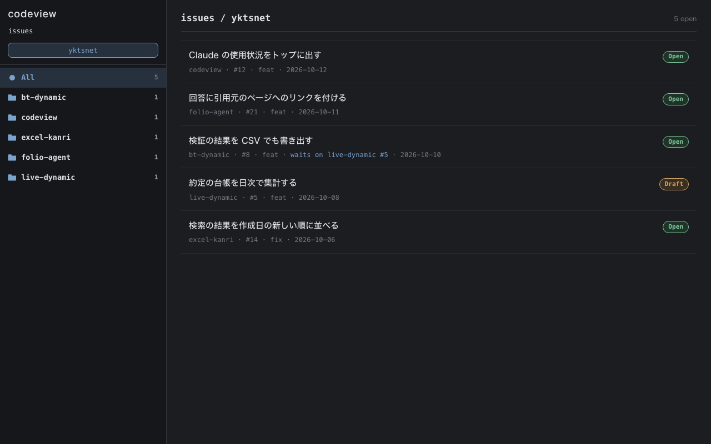
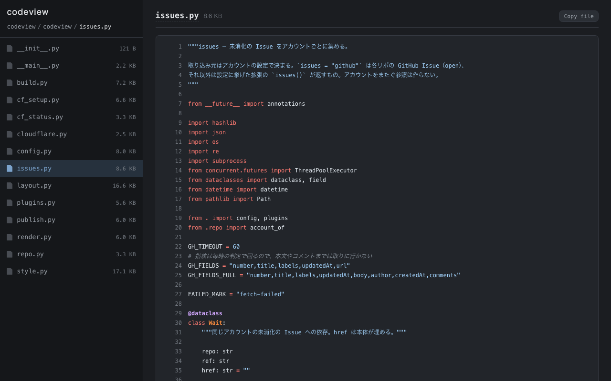
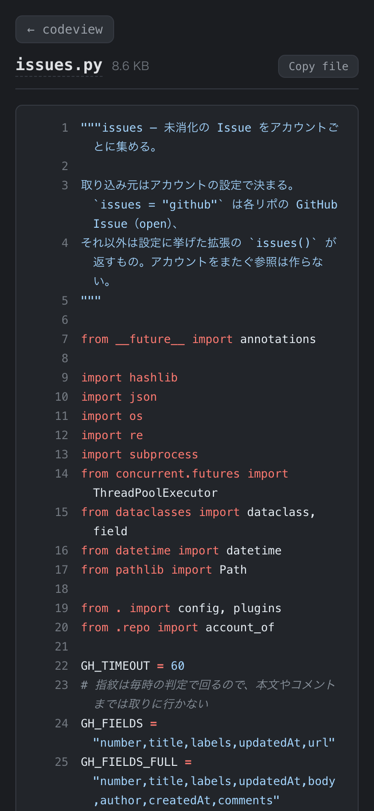
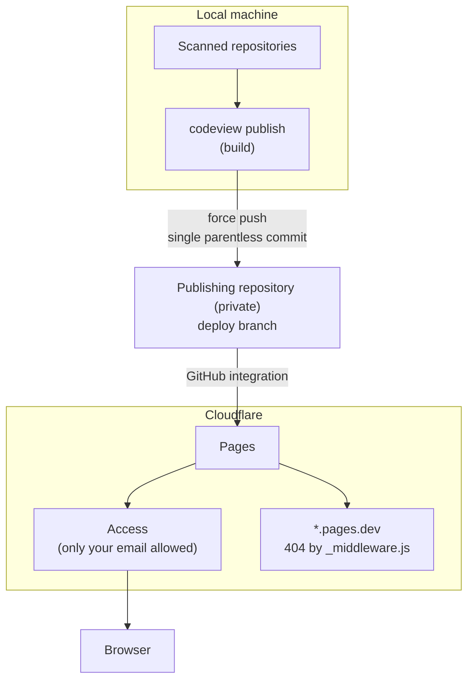

[🇯🇵 日本語](README.md) | [🇬🇧 English](README.en.md)

# codeview

[](https://github.com/yktsnet/codeview/actions/workflows/ci.yml)

Turns your local git repositories and their GitHub issues into static HTML, and serves them through Cloudflare Pages + Access as a code browser only you can read.

- **Read every repo in one place**: your local repos listed by root, with the code highlighted
- **All issues in one place too**: open issues from every repo in a single list
- **Multiple GitHub accounts**: pull issues from separate accounts, such as personal and work, and keep them apart
- **Light on a phone**: static HTML with no JavaScript, so it opens quickly while you're away

<p>
  
</p>
<p>
  
  
</p>

## Quick Start

You need `git`, plus an authenticated `gh` if you want issues. Python 3.11 or later.

```sh
# Nix
nix profile install github:yktsnet/codeview

# pip
pip install git+https://github.com/yktsnet/codeview
```

Write a `codeview.toml` in the directory you will work from.

```toml
[[roots]]
group = "src"
children = "~/src"     # read every git repository directly under it

[[accounts]]
name = "me"
hosts = ["github.com"]
groups = ["src"]
```

```sh
codeview build   # generate ./public/ and ./functions/
codeview serve   # check it at http://localhost:8787
```

No server is needed: open `public/index.html` in a browser and it reads as is (links are relative). Links in pages an extension writes in `build()` are the extension's responsibility.

That is enough to read locally. To read over the internet, continue to [Publishing](#publishing) below.

## Configuration

The config is TOML, read from the `CODEVIEW_CONFIG` environment variable, or `codeview.toml` in the working directory if unset. If it is missing, malformed or has unknown keys, codeview prints `error:` and stops before generating anything.

| Section | Meaning |
|---|---|
| `[[roots]]` | Where to scan. A `group`, plus exactly one of `path` (that directory is one repository) or `children` (every git repository directly under it). The order is the order of the left menu on the top page |
| `[scan]` | `skip_dirs` (directory names not to scan), `exclude_prefixes` (path prefixes not to output), `skip_exts` (extensions not to output) |
| `[[accounts]]` | The unit issues are grouped by; 1 or 2 of them. `name`, `hosts` (hosts of the `origin` remote), `groups` (the fallback when there is no remote), `issues` (the default `github`, or the module name of an extension that returns issues), `gh_config_dir` (the gh config dir used when `issues = "github"`) |
| `[publish]` | The `remote` (default `origin`) and `branch` (default `deploy`) to publish to |
| `[plugins]` | Extensions to load (`modules`). Per-extension settings go in `[plugins.<last part of the module name>]` |

For a second account, add another `[[accounts]]` block. This example reaches the work GitHub through an SSH Host alias (`github-work`).

```toml
[[accounts]]
name = "me"
hosts = ["github.com"]
groups = ["own"]

[[accounts]]
name = "work"
hosts = ["github-work"]
groups = ["work"]
gh_config_dir = "~/.config/gh-work"   # config dir where you ran gh auth login with the work account
```

## Extensions

The core outputs only code and issues. Anything else comes from the Python modules listed in `[plugins] modules`. Place them in the same directory as the config file. If loading fails, codeview stops before generating anything.

An extension has only the functions it needs from the following.

| Function | Role |
|---|---|
| `css(ctx)` | Appended to the end of the core CSS |
| `side(ctx)` | HTML inserted at the top of the left menu on the top page |
| `home(ctx)` | HTML shown on the right of the top page. `None` shows nothing |
| `build(ctx)` | Writes its own pages into `public/` and `functions/` |
| `before_publish(ctx)` | Called before publish detects changes |
| `fingerprint(ctx)` | One line added to change detection |
| `issues(ctx, account, repos)` | When an account's `issues` names this module, returns that account's open issues (`codeview.issues.Issue`) |

`ctx` holds the config, the scanned repositories, the output directories, the `[plugins.<name>]` table (`ctx.options`), and `ctx.read(repo, path)` to read a file at HEAD.

## Publishing

The generated files contain the code of every repository. **Keep the repository you publish from (the one holding `codeview.toml`) private, and never put the generated files anywhere public.**



### Publish

```sh
codeview publish               # build and push to the deploy branch
codeview publish --dry-run     # create the commit without pushing
codeview publish --if-changed  # do nothing if nothing changed since the last run (for scheduled runs)
```

`publish` creates a single parentless commit holding only `public/` and `functions/`, and force-pushes it to the `[publish]` branch. It does not touch the working tree or the index. Cloudflare Pages watches that branch, so the push triggers the deployment. Day-to-day publishing needs no Cloudflare API token.

### One-time: Cloudflare setup

```sh
export CF_API_TOKEN=... CF_ACCOUNT_ID=...   # or point CF_ENV_FILE at a dotenv-style file
codeview cf-setup code.example.net          # create the Pages project, custom domain, DNS and Access
codeview cf-status                          # show the project and recent deployments
```

Prerequisites:

- The domain's zone is on Cloudflare, and Cloudflare Zero Trust (Access) is enabled
- Your GitHub account is connected to Cloudflare Pages and can read the publishing repository
- The API token can edit Pages, DNS and Access (apps and policies)

`cf-setup` allows only the email address from `git config user.email`. Check the points it prints at the end (it asks you to log in, `*.pages.dev` returns 404, the site is readable after login) in a private window before using it.

`<project>.pages.dev` cannot be protected by Access. The `functions/_middleware.js` written by build blocks it by returning 404 for requests to that host.

## Scope

- Only each repository's HEAD is read. Uncommitted changes, history, branches, tags and diffs are not shown
- Files over 512 KiB and binary files are not shown
- Only Cloudflare Pages + Access is assumed as the host. The output is static files and can go elsewhere, but `cf-setup` and `_middleware.js` are for Cloudflare
- Cloudflare Pages allows 20,000 files per deployment. build warns when over it, and `publish` stops without pushing
- Up to two accounts

The externally visible behavior pinned by tests is listed in the [guarantee ledger](docs/guarantees.md) (Japanese).

## Design Decisions

- **The publish branch is recreated every time.** Nearly every generated file changes on each run, so accumulating history would make the repository grow without bound
- **Generation runs locally.** What it reads is your local repositories, so it does not run in CI. A push stays an ordinary push, and publishing happens only when you run `publish`
- **GitHub text is not trusted.** Other people's writing is rendered inside your own Access, so raw HTML and scripts are not output. Only an extension's issue source can allow raw HTML with `trusted`
- **The core holds no user values.** Scan targets, accounts and the publish target live in `codeview.toml` in the user's repository; the core holds only the generator

## Local Development

```sh
nix develop
nix develop -c pytest -q
```

## License

[MIT](LICENSE)
