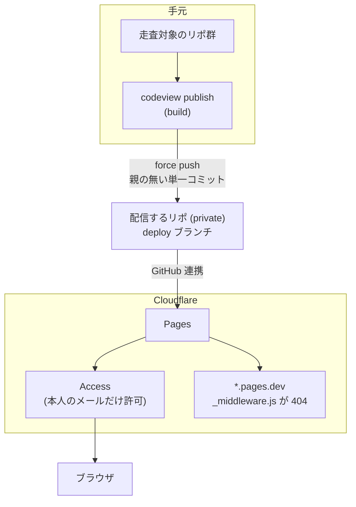

[🇯🇵 日本語](README.md) | [🇬🇧 English](README.en.md)

# codeview

[](https://github.com/yktsnet/codeview/actions/workflows/ci.yml)

手元の git リポジトリ群と、その GitHub Issue を静的 HTML にまとめ、自分だけが読めるコードブラウザとして Cloudflare Pages + Access で配信する。

GitHub の web やモバイルアプリは、コードを読むだけの用途には重い。codeview は手元のリポの HEAD を JavaScript なしでも読めるページに変換し、外出先のスマホからでも軽く読めるようにする。個人の GitHub と仕事の GitHub など、2つまでのアカウントのリポと Issue を1つのサイトに並べられる。

## Quick Start

前提は `git` と、Issue を取り込むなら認証済みの `gh`。Python 3.11 以上。

```sh
# Nix
nix profile install github:yktsnet/codeview

# pip
pip install git+https://github.com/yktsnet/codeview
```

置き場にするディレクトリに `codeview.toml` を書く。

```toml
[[roots]]
group = "src"
children = "~/src"     # 直下の git リポをすべて読む

[[accounts]]
name = "me"
hosts = ["github.com"]
groups = ["src"]
```

```sh
codeview build   # ./public/ と ./functions/ を生成
codeview serve   # http://localhost:8787 で確認する
```

手元で見るだけならここまでで足りる。インターネット越しに読むには、下の [Publishing](#publishing) へ進む。

## Configuration

設定は TOML で、場所は環境変数 `CODEVIEW_CONFIG`、無ければ作業ディレクトリの `codeview.toml`。無い・書式が誤っている・知らないキーがあるときは、生成を始める前に `error:` を出して止まる。

| 節 | 意味 |
|---|---|
| `[[roots]]` | 走査する置き場。`group` と、`path`（そのディレクトリが1つのリポ）か `children`（直下の git リポすべて）のどちらか一方。並び順がトップの左メニューの順になる |
| `[scan]` | `skip_dirs`（走査しないディレクトリ名）・`exclude_prefixes`（出力しないパスの接頭辞）・`skip_exts`（出力しない拡張子） |
| `[[accounts]]` | Issue をまとめる単位で、1〜2個。`name`・`hosts`（`origin` の remote のホスト）・`groups`（remote が無いときの決め手）・`issues`（既定の `github` か、Issue を返す拡張のモジュール名）・`gh_config_dir`（`issues = "github"` のときに使う gh の config dir） |
| `[publish]` | 配信先の `remote`（既定 `origin`）と `branch`（既定 `deploy`） |
| `[plugins]` | 読み込む拡張（`modules`）。拡張ごとの設定は `[plugins.<モジュール名の末尾>]` に置く |

アカウントを2つ使う例。仕事用の GitHub には SSH の Host 別名（`github-work`）で繋いでいるとする。

```toml
[[roots]]
group = "own"
children = "~/github"

[[roots]]
group = "work"
children = "~/work"

[scan]
skip_dirs = ["archive"]
exclude_prefixes = ["secrets/"]
skip_exts = [".png", ".jpg"]

[[accounts]]
name = "me"
hosts = ["github.com"]
groups = ["own"]

[[accounts]]
name = "work"
hosts = ["github-work"]
groups = ["work"]
gh_config_dir = "~/.config/gh-work"   # 仕事のアカウントで gh auth login した config dir
```

## What You Get

- **コード**: 各リポの HEAD のファイルごとにページを作り、Pygments でハイライトする。Markdown は描画し、ディレクトリに README があれば一覧の下に出す。未コミットの変更・履歴・ブランチは出さない
- **Issue**: アカウントごとに未消化の Issue を1本の一覧（`/issues/<account>/`）にまとめ、Issue ごとに本文とコメントを古い順に並べたページを作る。本文中の `#N` は、同じリポの未消化の Issue ならこのサイトのページへのリンクになる。GitHub の本文とコメントは他人の文章として扱い、生の HTML は文字として出す
- **コピー**: ファイルページのファイル名で手元の絶対パス、行番号で `パス:行番号`、`Copy file` で全文をコピーする。スマホで見つけた箇所をそのまま端末やエージェントに渡せる
- **表示幅**: Markdown 約 900px、Issue 約 1000px、コード約 1280px で止まる。760px 以下はスマホ向けの1カラムになる

Issue の取得に失敗したリポがあっても build は止まらず、一覧の上に `fetch failed: <repo>` と出す。

## Extensions

本体が出すのはコードと Issue だけで、それ以外は `[plugins] modules` に並べた Python のモジュールが足す。拡張は設定ファイルと同じディレクトリに置けば読める。読み込みに失敗したら、生成を始める前に止まる。

拡張は次の関数のうち、必要なものだけを持つ。

| 関数 | 役目 |
|---|---|
| `css(ctx)` | 本体の CSS の末尾に足す |
| `side(ctx)` | トップの左メニューの先頭に差し込む塊 |
| `home(ctx)` | トップの右側に出す HTML。`None` なら出さない |
| `build(ctx)` | `public/` と `functions/` に自前のページを書く |
| `before_publish(ctx)` | 配信の変更検出の前に呼ぶ |
| `fingerprint(ctx)` | 変更検出に足す1行 |
| `issues(ctx, account, repos)` | アカウントの `issues` にこのモジュールを挙げたとき、そのアカウントの未消化の Issue（`codeview.issues.Issue`）を返す |

`ctx` は設定・走査したリポの一覧・出力先・`[plugins.<名前>]` の表（`ctx.options`）・HEAD のファイルを読む `ctx.read(repo, path)` を持つ。`issues()` を使うと、GitHub 以外の台帳（リポの中の Issue ファイルなど）を取り込み元にできる。

## Publishing

生成物には全リポのコードが入る。**配信するリポ（`codeview.toml` を置いたリポ）は private にし、生成物を公開の場所に置かない。**



### 配信する

```sh
codeview publish               # build して deploy ブランチへ push する
codeview publish --dry-run     # コミットを作るだけで push しない
codeview publish --if-changed  # 前回の配信から変化が無ければ何もしない
```

`publish` は `public/` と `functions/` だけを載せた親の無い単一コミットを作り、`[publish]` の branch へ force push する。作業ツリーと index には触らない。Cloudflare Pages はそのブランチを見ており、push が配信を起こす。日常の配信に Cloudflare の API トークンは要らない。

`--if-changed` は、走査対象の HEAD・GitHub の open な Issue の更新・配信するリポの HEAD・codeview の版から指紋を作り、前回と同じなら build も push もしない。cron や launchd で毎時回すのに向く。未コミットの変更は指紋に出ないので、手元の試し書きが配信されることはない。

### 初回だけ: Cloudflare の設定

```sh
export CF_API_TOKEN=... CF_ACCOUNT_ID=...   # または CF_ENV_FILE に dotenv 形式のファイルを指す
codeview cf-setup code.example.net          # Pages プロジェクト・カスタムドメイン・DNS・Access を作る
codeview cf-status                          # プロジェクトと直近のデプロイを見る
```

前提:

- ドメインのゾーンが Cloudflare にあり、Cloudflare Zero Trust（Access）が有効になっている
- Cloudflare の Pages に GitHub アカウントを連携済みで、配信するリポを読める
- API トークンに Pages・DNS・Access（アプリとポリシー）の編集権限がある

`cf-setup` は Access のポリシーに `git config user.email` のメールアドレスだけを許可する。何度流しても既存のものは作り直さない。最後に出る3点（ログインを求められる・`*.pages.dev` が 404・ログイン後に読める）をプライベートウィンドウで確かめてから使う。

`<project>.pages.dev` は Access で保護できない。build が書く `functions/_middleware.js` がこのホストへのリクエストに 404 を返して塞いでいる。

## Scope

- 見るのは各リポの HEAD だけ。履歴・ブランチ・タグ・差分のページは作らない
- 512 KiB を超えるファイルとバイナリは中身を出さない
- 配信先は Cloudflare Pages + Access だけを想定する。生成物は静的ファイルなので他にも置けるが、`cf-setup` と `_middleware.js` は Cloudflare 向け
- Cloudflare Pages の上限は 1 デプロイ 20,000 ファイル。build は超えたら警告し、`publish` は push せずに止まる
- アカウントは2つまで

外から見える振る舞いのうち、テストで固定しているものは [保証台帳](docs/guarantees.md) にある。

## Tech Stack

| Layer | Technology | Reason |
|---|---|---|
| 生成器 | Python（標準ライブラリ + Pygments + Markdown） | 依存を2つに絞り、Nix でも pip でもそのまま入る。HTTP も `urllib` で足りる |
| リポの読み出し | `git ls-tree` / `git cat-file --batch` | 作業ツリーではなく HEAD を読むので、未コミットの変更が混ざらない |
| Issue の取得 | `gh` CLI | 認証を `gh` に任せ、アカウントごとに config dir を切り替えるだけで2つのアカウントを扱える |
| 配信 | Cloudflare Pages + Access | 静的ファイルの配信と、本人だけに絞る認証を同じ場所で持てる |
| 配布 | `pyproject.toml` と Nix flake | PyPI には出さない（`codeview` の名前は使用済み） |

## Design Decisions

- **配信ブランチは毎回作り直す。** 生成物は毎回ほぼ全ファイルが差し替わるので、履歴を積むとリポジトリが際限なく膨らむ
- **生成は手元で行う。** 読む対象が手元のリポ群なので、CI では走らせない。push はふつうの push のままにし、配信は `publish` を明示して起こす
- **GitHub の本文は信用しない。** 他の人が書いた本文を自分の Access の内側で描くので、生の HTML とスクリプトは出さない。拡張の取り込み元だけが `trusted` で生の HTML を許せる
- **本体は利用者の値を持たない。** 走査対象・アカウント・配信先は利用者のリポの `codeview.toml` に置き、本体は生成器だけを持つ

## Local Development

```sh
nix develop
nix develop -c pytest -q
```

テストは見本のリポ群・設定・偽の `gh` を一時ディレクトリに作り、生成器を別プロセスで回す。ネットワークにも Cloudflare にも出ない。

## License

[MIT](LICENSE)
