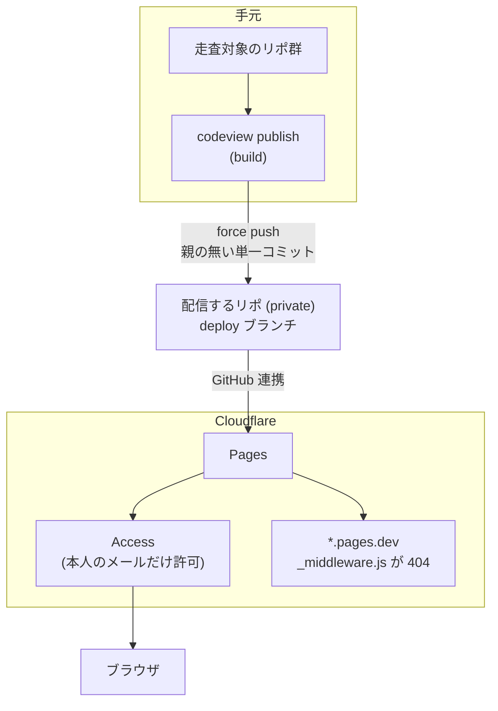

[🇯🇵 日本語](README.md) | [🇬🇧 English](README.en.md)

# codeview

[](https://github.com/yktsnet/codeview/actions/workflows/ci.yml)

手元の git リポジトリ群と、その GitHub Issue を静的 HTML にまとめ、自分だけが読めるコードブラウザとして Cloudflare Pages + Access で配信する。

- **全リポを1か所で読める**: 手元のリポを置き場ごとに並べ、コードをハイライトして読める
- **Issue も1か所にまとまる**: 全リポの未消化の Issue を1つの一覧にする
- **GitHub の複数アカウントに対応**: 個人用と仕事用のように、別々のアカウントの Issue を分けて取り込める
- **スマホで軽い**: JavaScript なしの静的 HTML なので、外出先でもすぐ開ける

<p>
  
</p>
<p>
  
  
</p>

## Quick Start

前提は `git` と、Issue を取り込むなら認証済みの `gh`。Python 3.11 以上。

```sh
# Nix
nix profile install github:yktsnet/codeview

# pip
pip install git+https://github.com/yktsnet/codeview
```

置き場にするディレクトリに `codeview.toml` を書く。

```toml
[[roots]]
group = "src"
children = "~/src"     # 直下の git リポをすべて読む

[[accounts]]
name = "me"
hosts = ["github.com"]
groups = ["src"]
```

```sh
codeview build   # ./public/ と ./functions/ を生成
codeview serve   # http://localhost:8787 で確認する
```

サーバーが無くても、`public/index.html` をブラウザで開けばそのまま読める（リンクは相対パス）。拡張が `build()` で書くページのリンクは拡張側の責任で、相対パスにするかどうかは拡張が決める。

手元で見るだけならここまでで足りる。インターネット越しに読むには、下の [Publishing](#publishing) へ進む。

## Configuration

設定は TOML で、場所は環境変数 `CODEVIEW_CONFIG`、無ければ作業ディレクトリの `codeview.toml`。無い・書式が誤っている・知らないキーがあるときは、生成を始める前に `error:` を出して止まる。

| 節 | 意味 |
|---|---|
| `[[roots]]` | 走査する置き場。`group` と、`path`（そのディレクトリが1つのリポ）か `children`（直下の git リポすべて）のどちらか一方。並び順がトップの左メニューのグループの順になる。グループの中は、ファイル数の多いリポから並ぶ |
| `[scan]` | `skip_dirs`（走査しないディレクトリ名）・`exclude_prefixes`（出力しないパスの接頭辞）・`skip_exts`（出力しない拡張子）。リポごとに足すときは `[scan.repos."<slug>"]` に `skip_exts` と `exclude_prefixes` を書く（全体の値に足される。slug はページのパスと同じ） |
| `[[accounts]]` | Issue をまとめる単位で、1〜2個。`name`・`hosts`（`origin` の remote のホスト）・`groups`（remote が無いときの決め手）・`issues`（既定の `github` か、Issue を返す拡張のモジュール名）・`gh_config_dir`（`issues = "github"` のときに使う gh の config dir）・`check_every_hours`（`publish --if-changed` がこのアカウントのリポの変化を見る間隔。時間単位の正の整数。省けば毎回見る） |
| `[publish]` | 配信先の `remote`（既定 `origin`）と `branch`（既定 `deploy`） |
| `[plugins]` | 読み込む拡張（`modules`）。拡張ごとの設定は `[plugins.<モジュール名の末尾>]` に置く |

画像の多いリポだけ画像を外す例。他のリポは全体の `[scan]` のままになる。

```toml
[scan.repos."hi"]
skip_exts = [".png", ".jpg"]
exclude_prefixes = ["assets/"]
```

2つ目のアカウントは `[[accounts]]` をもう1つ足す。仕事用の GitHub に SSH の Host 別名（`github-work`）で繋いでいる例。

```toml
[[accounts]]
name = "me"
hosts = ["github.com"]
groups = ["own"]

[[accounts]]
name = "work"
hosts = ["github-work"]
groups = ["work"]
gh_config_dir = "~/.config/gh-work"   # 仕事のアカウントで gh auth login した config dir
```

## Extensions

本体が出すのはコードと Issue だけで、それ以外は `[plugins] modules` に並べた Python のモジュールが足す。設定ファイルと同じディレクトリに置けば読める。読み込みに失敗したら、生成を始める前に止まる。

拡張は次の関数のうち、必要なものだけを持つ。

| 関数 | 役目 |
|---|---|
| `css(ctx)` | 本体の CSS の末尾に足す |
| `side(ctx)` | トップの左メニューの先頭に差し込む HTML |
| `home(ctx)` | トップの右側に出す HTML。`None` なら出さない |
| `build(ctx)` | `public/` と `functions/` に自前のページを書く |
| `before_publish(ctx)` | 配信の変更検出の前に呼ぶ |
| `fingerprint(ctx)` | 変更検出に足す1行 |
| `issues(ctx, account, repos)` | アカウントの `issues` にこのモジュールを挙げたとき、そのアカウントの未消化の Issue（`codeview.issues.Issue`）を返す |

`ctx` は設定・走査したリポの一覧・出力先・`[plugins.<名前>]` の表（`ctx.options`）・HEAD のファイルを読む `ctx.read(repo, path)` を持つ。

## Publishing

生成物には全リポのコードが入る。**配信するリポ（`codeview.toml` を置いたリポ）は private にし、生成物を公開の場所に置かない。**



### 配信する

```sh
codeview publish               # build して deploy ブランチへ push する
codeview publish --dry-run     # コミットを作るだけで push しない
codeview publish --if-changed  # 前回から変化が無ければ何もしない（定期実行向け）
```

`publish` は `public/` と `functions/` だけを載せた親の無い単一コミットを作り、`[publish]` の branch へ force push する。作業ツリーと index には触らない。Cloudflare Pages はそのブランチを見ており、push が配信を起こす。日常の配信に Cloudflare の API トークンは要らない。

`--if-changed` が見る変化は、走査対象のリポと配信するリポのコミット、本体の版、拡張の `fingerprint()` である。GitHub の Issue だけが動いても配信しない。Issue は、次にコミットなどの変化で配信するときに載る。

### 初回だけ: Cloudflare の設定

```sh
export CF_API_TOKEN=... CF_ACCOUNT_ID=...   # または CF_ENV_FILE に dotenv 形式のファイルを指す
codeview cf-setup code.example.net          # Pages プロジェクト・カスタムドメイン・DNS・Access を作る
codeview cf-status                          # プロジェクトと直近のデプロイを見る
```

前提:

- ドメインのゾーンが Cloudflare にあり、Cloudflare Zero Trust（Access）が有効になっている
- Cloudflare の Pages に GitHub アカウントを連携済みで、配信するリポを読める
- API トークンに Pages・DNS・Access（アプリとポリシー）の編集権限がある

`cf-setup` は `git config user.email` のメールアドレスだけを許可する。最後に出る確認（ログインを求められる・`*.pages.dev` が 404・ログイン後に読める）をプライベートウィンドウで済ませてから使う。

`<project>.pages.dev` は Access で保護できない。build が書く `functions/_middleware.js` がこのホストへのリクエストに 404 を返して塞いでいる。

## Scope

- 見るのは各リポの HEAD だけ。未コミットの変更・履歴・ブランチ・タグ・差分は出ない
- 512 KiB を超えるファイルとバイナリは中身を出さない
- 配信先は Cloudflare Pages + Access だけを想定する。生成物は静的ファイルなので他にも置けるが、`cf-setup` と `_middleware.js` は Cloudflare 向け
- Cloudflare Pages の上限は 1 デプロイ 20,000 ファイル。build は超えたら警告し、`publish` は push せずに止まる
- アカウントは2つまで

外から見える振る舞いのうち、テストで固定しているものは [保証台帳](docs/guarantees.md) にある。

## Design Decisions

- **配信ブランチは毎回作り直す。** 生成物は毎回ほぼ全ファイルが差し替わるので、履歴を積むとリポジトリが際限なく膨らむ
- **生成は手元で行う。** 読む対象が手元のリポ群なので、CI では走らせない。push はふつうの push のままにし、配信は `publish` を明示して起こす
- **GitHub の本文は信用しない。** 他の人が書いた本文を自分の Access の内側で描くので、生の HTML とスクリプトは出さない。拡張の取り込み元だけが `trusted` で生の HTML を許せる
- **本体は利用者の値を持たない。** 走査対象・アカウント・配信先は利用者のリポの `codeview.toml` に置き、本体は生成器だけを持つ

## Local Development

```sh
nix develop
nix develop -c pytest -q
```

## License

[MIT](LICENSE)
